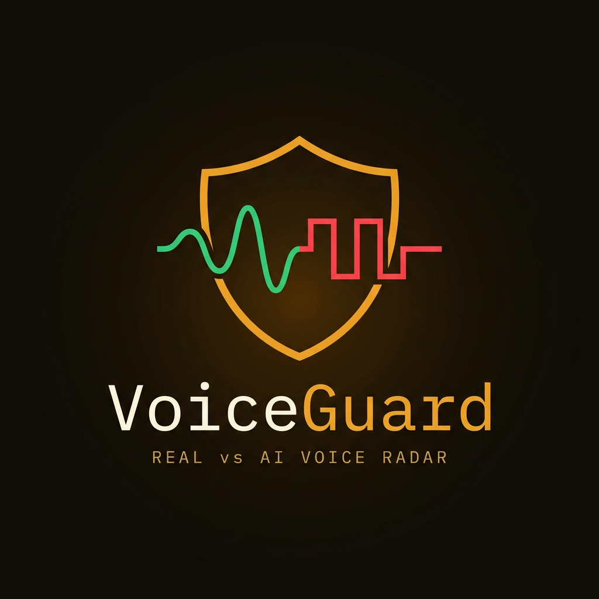
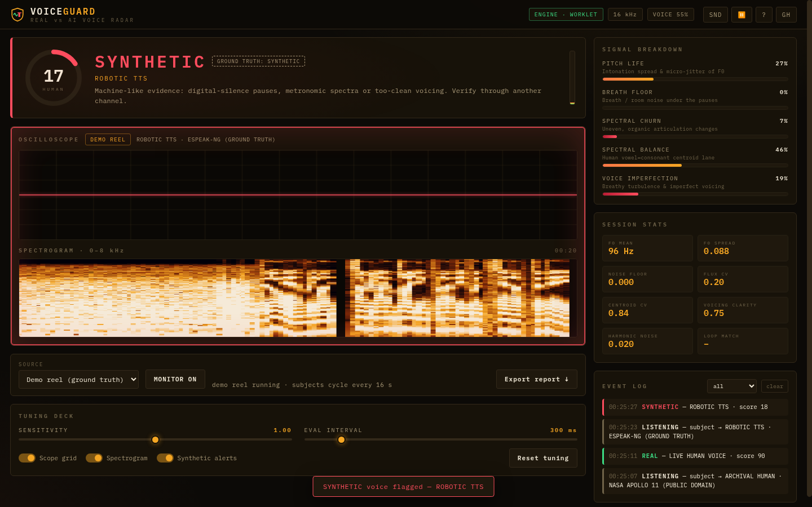
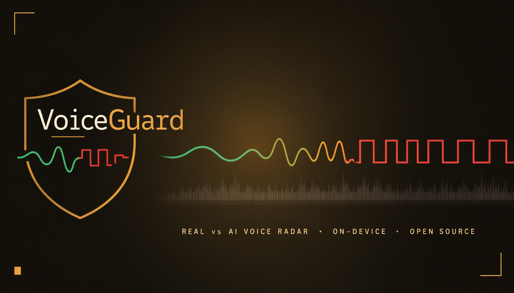

<div align="center">

<picture><source media="(prefers-color-scheme: dark)" srcset="promo/logo-white.png"></picture>

# VoiceGuard — Real vs AI Voice Radar

</div>



Open-source Chrome extension (Manifest V3) that flags **robotic TTS, looped replays and synthetic voices** in your video meetings, in any browser tab you share, or on your own microphone — entirely on-device. One live verdict for the voice in the stream: **REAL**, **SUSPECT** or **SYNTHETIC**, with a five-signal breakdown, oscilloscope and spectrogram you can inspect.

No cloud. No uploads. No audio ever leaves your machine. The sibling of [AIFaceDetector](https://github.com/aisac-id/aifacedetector) — faces covered there, voices here.

## What it does

- **Meeting radar** — share your Meet / Zoom / Teams tab (tick *“Also share tab audio”*) and the console scores whoever is speaking.
- **Browse radar** — the same capture works on any tab: videos, streams, voice notes, webinars.
- **Mic check** — point it at your microphone (processing deliberately disabled so the noise floor stays honest) and watch a live human score high.
- **Demo reel** — two bundled subjects with ground truth, cycling every 16 s:
  - a **real human voice** — NASA Apollo 11 archival radio (public domain),
  - a **robotic TTS voice** rendered with espeak-ng.
- **Five authenticity signals per voice**, shown as live meters:
  1. **Pitch life** — intonation spread and micro-jitter of the voice fundamental.
  2. **Breath floor** — real rooms carry breath/hiss under pauses; TTS renders digital silence.
  3. **Spectral churn** — organic articulation changes are uneven; vocoders are metronomic.
  4. **Spectral balance** — formant TTS swings violently between buzz and noise bands.
  5. **Voice imperfection** — breathy turbulence between harmonics; synthetic vowels are too clean.
- **Verdict dial + subtype** — `ROBOTIC TTS`, `LOOPED / REPLAYED AUDIO` or `SYNTHETIC VOICE`, with plain-language advice.
- **Replay watchdog** — a whitened 48-band spectral fingerprint compares the last 30 s against itself; a sustained near-perfect match raises the `LOOP?` chip.
- **Broadcast console** — verdict-colored oscilloscope, scrolling log-frequency spectrogram (60 Hz–8 kHz), input level strip and session stats (F0, noise floor, flux CV, centroid CV, voicing clarity, harmonic noise, loop match).
- **Synthetic alerts** — red flash, console beep and toast when the verdict crosses into SYNTHETIC (5 s cooldown).
- **Event log** — every verdict change and subject switch, filterable (all / synthetic / real), capped at 100.
- **Export report** — one click downloads a JSON report: verdict, signal values, stats, tuning and event history.
- **Tuning deck** — sensitivity (snap re-score), eval interval, scope grid, spectrogram, alerts, monitor mute.
- **Background-safe analysis** — PCM is captured on the audio rendering thread via an AudioWorklet, so listening continues even when the console tab is in the background.
- Keyboard: `Space` pause · `M` monitor · `S` sound · `?` help · `Esc` close.

## Install (load unpacked)

1. Clone or download this repo.
2. Open `chrome://extensions`, enable **Developer mode**.
3. **Load unpacked** → select the `voiceguard` folder.
4. Click the toolbar icon. The demo reel starts immediately: the human voice goes green, the TTS voice gets flagged red within seconds.

## Scan a meeting

1. Join the meeting in a normal Chrome tab.
2. In VoiceGuard choose **Source → Meeting / tab audio**, press **Share tab / screen…**.
3. Select the **meeting tab** and tick **“Also share tab audio”** — without that checkbox there is no audio to analyze (the app tells you if you forget).
4. Read the verdict: green **REAL**, amber **SUSPECT**, red **SYNTHETIC**.

## How the verdict is computed

The engine accumulates a ~6.5 s window of 64 ms frames (16 kHz mono), then:

```
authenticity = 100 × ( 0.08·pitch + 0.34·breath + 0.14·churn
                     + 0.14·air + 0.30·period ) × sensitivity
```

- **≥ 62 → REAL** · **36–61 → SUSPECT** · **< 36 → SYNTHETIC**
- The score is exponentially smoothed so one fricative-heavy window can't flip the verdict.
- The sensitivity slider re-scores instantly so you can feel the trade-off.
- Calibration reference (bundled demo, sensitivity 1.0): archival human ≈ **82–97 REAL**, espeak TTS ≈ **17–33 SYNTHETIC**.

## Honest limits (read this)

This is an **on-device heuristic triage tool, not a forensic voice-clone classifier**:

- High-quality neural TTS / voice clones that breathe, jitter and add room tone can pass.
- Heavily processed real voices — noise gates, aggressive codecs, studio silence — can dip into SUSPECT.
- Robotic TTS, digital-silence replays and looped audio are the strong cases.
- One stream = one verdict: in a multi-speaker meeting the score follows whoever is talking.
- Use it responsibly and with consent; check your local laws before analyzing other people.

## Privacy

- All analysis is local (hand-rolled DSP + AudioWorklet, no models, no network). The only inputs are the streams you explicitly share.
- No host permissions, no content scripts, no analytics. `storage` is used only for tuning preferences.
- Mic capture disables echo cancellation / noise suppression / AGC **locally** so the breath-floor signal stays truthful — nothing is transmitted.

## Tech notes

- Manifest V3, no build step, zero runtime dependencies.
- `js/dsp.js` — fixed-size radix-2 FFT, autocorrelation pitch (octave-safe peak picking), band energy, spectral flatness.
- `js/vg-worklet.js` — AudioWorklet PCM tap (1024-sample chunks) that keeps running on the audio thread in background tabs.
- `js/analysis.js` — adaptive percentile speech gate, five-signal scoring, replay fingerprinting with per-band whitening.
- Demo assets are lossless WAV on purpose: lossy codecs smear energy into silence and would fake a breath floor.

## Layout

```
voiceguard/
├── manifest.json        MV3 manifest (storage only)
├── background.js        toolbar icon → console tab
├── app.html             broadcast console UI
├── css/                 theme + bundled IBM Plex Mono
├── js/
│   ├── app.js           UI, scopes, eval loop, report
│   ├── analysis.js      five-signal authenticity engine
│   ├── dsp.js           FFT / pitch / spectral toolbox
│   ├── vg-worklet.js    background-safe PCM tap
│   ├── sources.js       demo reel / mic / tab audio
│   └── audio.js         console sounds
├── assets/              demo voices (NASA PD + espeak-ng)
├── promo/               logo, software box, poster, banner, video
└── docs/                screenshots
```

## Promo kit

All artwork is AI-generated for this project — free to reuse under the same MIT license.

| Asset | File |
| --- | --- |
| Logo | [`promo/logo.png`](promo/logo.png) |
| Logo (dark mode) | [`promo/logo-white.png`](promo/logo-white.png) |
| Software box | [`promo/software-box.png`](promo/software-box.png) |
| Poster | [`promo/poster.png`](promo/poster.png) |
| Banner | [`promo/banner.png`](promo/banner.png) |
| Promo video (8 s, 1080p) | [`promo/promo.mp4`](promo/promo.mp4) |



## Credits

- Demo human voice: **NASA Apollo 11** air-to-ground recording (“one small step”), public domain, via [Wikimedia Commons](https://commons.wikimedia.org/wiki/File:Neil_Armstrong_small_step.wav).
- Demo synthetic voice rendered with **espeak-ng** (the generated audio output is free to use).
- Bundled font: **IBM Plex Mono** © IBM, SIL Open Font License 1.1.

## License

MIT © 2026 aisac-id. See [LICENSE](LICENSE).